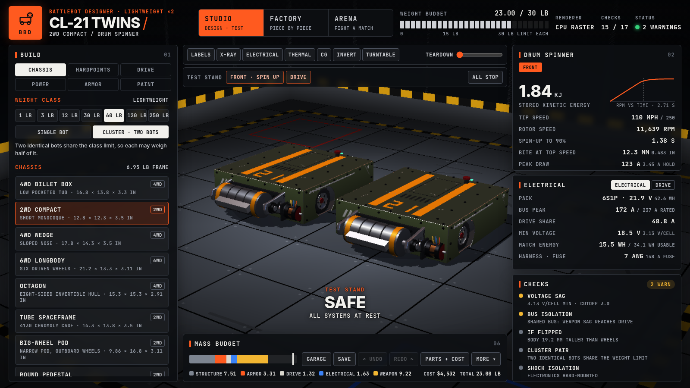

# BattleBot Designer

A browser application for configuring a combat robot and inspecting the result in 3D. You pick a
chassis, bolt modules onto its hardpoints, choose drive, power and armour, and the app computes
weight, electrical and drive figures and a list of engineering checks, and builds a procedural 3D
model of the configuration. A small Flask server (`server.py`) serves the page and static files;
all of the modelling runs in the browser.

Version: 0.1.0 (see `VERSION` and `CHANGELOG.md`).



<!-- Screenshot placeholder: docs/screenshot.png has not been added yet. -->

## Features

Each item below was checked against the code at the time of writing. The files under `static/` were
being edited while this was written, so re-check the list before a release.

- 17 chassis, including two walkers (quadruped, hexapod), a tracked crawler, a three-wheeler,
  U-frame, H-frame, delta, pancake and a melty puck.
- 36 hardpoint modules in six categories (kinetic 17, control 6, thermal 1, electrical 1,
  projectile 5, passive 6), mounted on five hardpoints (front, top, rear, left, right).
- Interference checking: the configurator refuses a module that would clash with one already
  installed, and a clash in a loaded build is reported as a failed check.
- Full-body shell spinner and ring spinner modules; with a shell fitted, a top module either stays
  still on a centre mast or rides the spinning shell.
- Weight classes from 1 lb to 250 lb (1, 3, 12, 30, 60, 120, 250 lb).
- Adjustable chassis dimensions.
- Armour as one plate specification or face by face (front, side, rear, top).
- Drive options: wheel count, tyre compound, floor magnets, wheel guards, two-speed gearbox,
  suspension, hub motors, omni and mecanum wheels.
- Optional components: gyro, fans, shock mounts, capacitor bank, telemetry, weapon brake, redundant
  receiver, armoured battery box, FPV camera.
- N2 or CO2 pneumatics.
- Ballast with adjustable position.
- Cost estimate, shown on screen and in the parts list.
- Liveries, custom paint (three colours), three finish levels and team text.
- Studio and Factory Floor modes.
- View modes: labels, x-ray, electrical overlay, thermal overlay, centre-of-gravity marker, inverted
  view, turntable.
- Teardown slider that separates the model down to individual pieces.
- Test stand: per-module actions and drive.
- Garage (builds saved in the browser's `localStorage`), parts list with CSV download, "tale of the
  tape" summary, PNG snapshot.
- Arena mode: a top-down 2D match against an AI opponent (three difficulty levels) with a per-face
  damage model, arena hazards, a 3:00 clock, knockout count, three judges' scorecards and instant
  replay. Controls: W A S D drive; SPACE fires; with several weapons, SPACE + an arrow key fires the
  weapon on that side (up = front, down = rear, left, right) and SPACE alone fires the top weapon.
  The match view, HUD and key hints were checked in a browser; the result card and replay controls
  have only been run against a stub page, and damage constants are game-level tuning.

## Requirements

- Python 3 with the `venv` module (or the `virtualenv` package), to run the server. The only Python
  dependency is Flask (`requirements.txt`).
- A current desktop browser. WebGL is used when available; it is not required (see below).
- Node.js, only for the tests and the offline render tool. Developed with Node 20. No npm packages
  are needed.
- `tools/shot.sh` additionally needs `google-chrome`.

## Quick start

```
./run.sh
```

Then open http://127.0.0.1:8105.

`run.sh` creates or reuses a virtualenv in `./.venv`, installs `requirements.txt` and starts the
server. Environment variables:

| Variable | Default | Meaning |
|---|---|---|
| `PORT` | `8105` | Port to listen on |
| `HOST` | `0.0.0.0` | Bind address. The default listens on all network interfaces; use `HOST=127.0.0.1` to accept local connections only |
| `PYTHON` | `python3` | Interpreter used to create the virtualenv |
| `VENV_DIR` | `.venv` | Virtualenv location |
| `BBD_SETUP_ONLY` | unset | Set to `1` to create the virtualenv and install requirements without starting the server |

The server is Flask's built-in development server. `server.py` also accepts `--host` and `--port`,
which override the environment variables. `GET /api/health` returns a small JSON status.

## Renderer fallback

The app uses three.js with WebGL when the browser provides it. When WebGL is unavailable it falls
back to a built-in CPU renderer (a software z-buffer rasteriser in `static/bb_engine.js`). Adding
`?sw=1` to the URL forces the CPU renderer. The Node checks and `tools/render_node.js` use the CPU
path.

## Running the tests

```
tools/test.sh
```

This runs, in order: a `node --check` syntax pass, `tools/check_presets.js matrix`,
`tools/check_models.js`, `tools/check_teardown_spin.js`, `tools/check_app.js`, and
`tools/check_arena.js` (skipped with a message if the file is missing). Every step
runs even if an earlier one fails; a summary is printed and the exit status is non-zero if any step
failed. The checks need only Node: no browser and no running server. `tools/check_models.js` is the
slow step (several minutes on the development machine).

The checks confirm that the code runs and produces finite numbers and geometry for every
combination. They do not check page layout or the correctness of the engineering figures.

## URL automation parameters

The page reads these query parameters on load (`static/bb_app.js`, plus `sw` in
`static/bb_engine.js`). Example: `http://127.0.0.1:8105/?preset=drum&xray=1&teardown=0.6`.

| Parameter | Values | Effect |
|---|---|---|
| `preset` | `vertical`, `drum`, `bar`, `shell`, `flipper`, `hammer`, `crusher`, `pyro`, `k9`, `whip`, `franken`, `ring`, `melty`, `tank`, `hexa`, `ubay`, `cat`, `dart`, `slab`, `trike`, `pair` | Load a built-in preset |
| `b` | share code | Load a build from a share link (takes priority over `preset`) |
| `mode` | `factory` | Start in Factory Floor mode |
| `station` | integer | Factory Floor station index (with `mode=factory`) |
| `drop` | number | Start a part drop-in at that time offset (with `mode=factory`) |
| `tab` | `chassis`, `hard`, `drive`, `power`, `armor`, `paint` | Configurator tab |
| `slot` | `front`, `top`, `rear`, `left`, `right` | Selected hardpoint |
| `hp` | `tune` | Open the hardpoint's tuning tab instead of the module list |
| `labels` | `1` | Show labels |
| `xray` | `1` | X-ray view |
| `overlay` | `electrical`, `thermal` | Overlay view |
| `cg` | `1` | Show the centre-of-gravity marker |
| `invert` | `1` | Show the bot inverted |
| `turn` | `1` | Turntable rotation |
| `teardown` | `0` to `1` | Teardown amount |
| `az`, `el`, `zoom` | numbers | Camera azimuth, elevation and zoom |
| `act` | comma-separated hardpoints | Hold those modules in their active state |
| `t` | seconds | Time into a spin-up, for spinning modules named in `act` |
| `chop` | `1` | With `act`, hold a chopping module in its struck position |
| `drive` | `1` | Run the drive on the test stand |
| `modal` | `bom`, `tape`, `share`, `compare`, `about` | Open that dialog (parts list, tale of the tape, share / import, compare, about) |
| `tools` | `1` | Open the tools menu |
| `arena` | `1`, `go` | Open arena mode (`go` also starts the match) |
| `garage` | `1` | Open the garage |
| `sw` | `1` | Force the CPU renderer |

## Project layout

```
server.py                    Flask server: serves templates/index.html, /static/* and /api/health
run.sh                       Creates/reuses .venv, installs requirements.txt, starts server.py
requirements.txt             Python dependency (Flask)
VERSION                      Version number
templates/index.html         The single page: HUD markup and the script tags (load order matters)
static/bb.css                Stylesheet: fixed 1600 x 900 stage scaled to the window; @font-face rules
static/bb_physics.js         Parts catalog and engineering model; pure data and maths, also runs in Node
static/bb_engine.js          3D engine: viewport scaling, WebGL renderer with CPU z-buffer fallback, sets, lights, camera
static/bb_kit.js             Model kit: liveries, materials and geometry helpers shared by the builders
static/bb_modules.js         Hardpoint module builders, one per module family, with animation handles
static/bb_models.js          Procedural 3D assembly of a computed build: frame, drivetrain, electrics, modules, armour
static/bb_app.js             Application layer: Studio and Factory Floor modes, HUD, view modes, test stand, exports
static/bb_arena.js           Arena mode: seeded combat simulation (also runs in Node) plus the 2D canvas renderer, HUD and replay
static/bb_arena.css          Arena mode styles
static/three.min.js          three.js r128 (third party)
static/fonts/                Inter and JetBrains Mono .woff2 files (third party)
tools/test.sh                Runs all the Node checks; exits non-zero on failure
tools/check_presets.js       Prints weight/legality for every preset; "matrix" runs every chassis x module x hardpoint through the engineering model
tools/check_models.js        Builds the 3D model for every chassis x module x hardpoint combination and every preset; catches exceptions and NaN geometry
tools/check_teardown_spin.js Checks that exploded pieces inside a turning parent stay put while the parent rotates
tools/check_app.js           Smoke test of the application layer against a fake DOM, in Studio and Factory modes
tools/check_arena.js         Arena mode check: every bot spec builds, and seeded AI-vs-AI matches finish, deal damage and are reproducible
tools/render_node.js         Offline render: runs the engine's CPU path under Node and writes a PNG
tools/shot.sh                Headless-Chrome screenshot of the running app into renders/ui/
docs/ci.yml     CI: byte-compiles server.py and runs tools/test.sh
docs/                        Documentation assets (screenshot placeholder)
renders/                     Generated screenshots and logs (git-ignored)
THIRD_PARTY_NOTICES.md       Versions, sources and licences of bundled third-party files
CHANGELOG.md, CONTRIBUTING.md
```

## Rules and accuracy

The app applies two rule limits, both defined in `static/bb_physics.js`: a 250 lb heavyweight weight
limit and a 250 mph weapon tip-speed limit. It also lists seven weight classes. These were checked
by web search in November 2026. **The official BattleBots rules document could not be opened during
that check**, so everything below rests on search-result summaries of the rules and of secondary
sources, not on a reading of the rule text. Check https://battlebots.com/rules/ before relying on
any of it.

| App value | Status | Notes |
|---|---|---|
| Heavyweight limit 250 lb | Consistent with the sources found; not confirmed against the rule text | Search summaries report the BattleBots design rules as giving a maximum weight of 250 pounds, with allowances that the app does not model |
| Weapon tip speed limit 250 mph | Approximate | Search summaries disagree on the wording: some state "250 mph", others report the rule as a maximum part speed of 370 ft/s, which is about 252 mph. The app's 250 mph should be read as a round figure |
| Antweight 1 lb, beetleweight 3 lb, hobbyweight 12 lb, featherweight 30 lb, lightweight 60 lb, middleweight 120 lb | Consistent with US-style classes in the sources found; not confirmed against a ruleset | These names mean different weights elsewhere. UK-style classes were reported as antweight 150 g, beetleweight 1.5 kg, featherweight 13.6 kg and heavyweight 110 kg |
| Heavyweight 250 lb as a general class | Organisation-specific | 250 lb is the televised BattleBots figure; other organisations were reported with lower heavyweight limits (220 lb, 110 kg) |

Not checked: the 180-second match length the model uses for its energy budget, and every other
check threshold in the app. Those are the app's own engineering heuristics, not rules of any
competition.

This project is not affiliated with or endorsed by BattleBots or any other competition organiser.

## Model limits

- The parts catalog is a set of representative component classes. The figures are not datasheet
  values for real products.
- Thermal, electrical and projectile weapons use simplified, game-level models.
- Prices are rough estimates, not quotes.
- All calculations run at heavyweight scale. Smaller weight classes are shown as dynamically
  similar scale models of the heavyweight calculation (the finished figures are rescaled by unit);
  they are not designed independently for their class.
- The engineering checks are simplified. Passing them does not show that a design is safe, legal at
  any event, or buildable. Do not use this app as a basis for building a real machine.

## Third-party components

three.js r128 (MIT) and the Inter and JetBrains Mono fonts (SIL Open Font License 1.1) are bundled
under `static/` and served locally; nothing is loaded from a CDN. See `THIRD_PARTY_NOTICES.md`.

## Licence

MIT; see [LICENSE](LICENSE). The bundled third-party files remain under their own licences (see
[THIRD_PARTY_NOTICES.md](THIRD_PARTY_NOTICES.md)).
